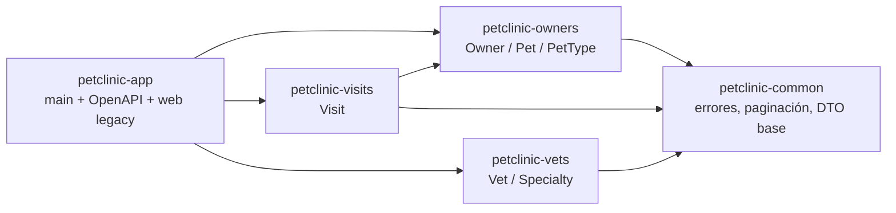

# 02 - Arquitectura objetivo

## 1. Decisión

**Monolito modular** en Maven multi-módulo, desplegado como un único artefacto Spring Boot.

Motivos:

- El documento de la prueba acepta explícitamente un monolito modular bien delimitado.
- `Owner`, `Pet` y `Visit` tienen relaciones JPA fuertes; separarlos en servicios independientes
  exigiría transacciones distribuidas o duplicación de datos sin aportar valor en 1 día.
- Un artefacto único garantiza la condición crítica de reproducibilidad desde un clon limpio.
- Se mantienen límites de módulo verificables con ArchUnit y con las dependencias de Maven.

Alternativas descartadas: microservicios por entidad (consistencia y operación costosas),
microservicios por capacidad con BD separadas (fuera de alcance), proyecto nuevo sin relación con
el legacy (prohibido por el documento).

## 2. Módulos y dependencias



Reglas:

- `common` no depende de nadie.
- `owners`, `visits` y `vets` solo dependen de `common` (y `visits` de `owners`).
- `app` es el único que conoce a todos y contiene el `main`.
- Ningún módulo accede a repositorios de otro módulo.
- `visits` valida la existencia de la mascota mediante el puerto `PetLookup`, implementado por
  `owners`. No accede a `PetRepository` directamente.

## 3. Estructura interna de cada módulo

```
<modulo>/
├── api/            # controladores REST, DTO de entrada/salida, mappers
├── application/    # casos de uso y transacciones
├── domain/         # entidades y reglas de negocio
└── infrastructure/ # repositorios JPA y adaptadores
```

La estructura es orientativa; lo evaluable es la separación de responsabilidades.

## 4. Contratos REST

- Base: `/api/v1`.
- JSON en entrada y salida; DTO, nunca entidades JPA.
- Validación de entrada con Bean Validation (`@Valid`).
- Errores con `ProblemDetail` (RFC 9457): `type`, `title`, `status`, `detail`, `instance` y
  `errors[]` para fallos de validación.
- Códigos: 200/201/204 éxito, 400 validación, 404 no encontrado, 409 conflicto (mascota duplicada),
  500 error no controlado.
- Paginación: `page` (1-based, como el legacy), `size` (por defecto 5, máximo 100).
- Fechas en ISO-8601 (`yyyy-MM-dd`).

Endpoints previstos:

| Recurso | Endpoints |
|---|---|
| Owners | `GET /api/v1/owners`, `GET /{id}`, `POST`, `PUT /{id}` |
| Pet types | `GET /api/v1/pet-types` |
| Pets | `POST /api/v1/owners/{ownerId}/pets`, `PUT /api/v1/owners/{ownerId}/pets/{petId}` |
| Visits | `GET /api/v1/owners/{ownerId}/pets/{petId}/visits`, `POST` |
| Vets | `GET /api/v1/vets`, `GET /{id}` |

## 5. OpenAPI

- `springdoc-openapi-starter-webmvc-ui` 3.2.0 (compatible con Spring Boot 4).
- Swagger UI: `/swagger-ui.html`.
- Especificación: `/v3/api-docs`.
- La especificación se genera automáticamente a partir de los controladores y DTO; los metadatos
  (título, versión, descripción) se declaran en `OpenApiConfiguration`.

## 6. Persistencia

- Una sola base de datos, propiedad del monolito modular.
- H2 en memoria por defecto para desarrollo, pruebas y clon limpio.
- Perfiles `mysql` y `postgres` con `docker-compose.yml`.
- Esquema y datos por scripts existentes; sin migraciones versionadas (deuda aceptada y
  documentada para no ampliar el alcance).
- Búsqueda case-insensitive resuelta en consulta (`lower(...)`) para no depender de
  `VARCHAR_IGNORECASE` de H2.

## 7. Capa web

Thymeleaf y los controladores MVC **se retiran**: el documento de la prueba permite expresamente
eliminar el frontend server-side y la evaluación es de backend. Los flujos que antes se hacían por
formularios se ejecutan ahora contra `/api/v1`.

Como valor agregado se añadió una **SPA estática** (`petclinic-app/src/main/resources/static`) escrita
en HTML, CSS y JavaScript sin build ni dependencias externas. Spring Boot la sirve en `/` y consume la
misma API pública; no introduce controladores MVC, plantillas ni acoplamiento al dominio. Se eligió
esta opción frente a React/Vite para no añadir Node al entorno reproducible del evaluador.

La SPA consume exactamente los **DTO del contrato REST** (`OwnerResponse`, `PetResponse`,
`VisitResponse`, `VetResponse`, `PetTypeResponse`) y los `Request` correspondientes para escribir.
No conoce las entidades JPA ni los repositorios: la frontera de módulos que define este documento se
mantiene también en el cliente.

Motivo de la retirada de MVC: mantener dos capas de presentación (MVC y REST) duplicaba controladores,
plantillas y pruebas, y aumentaba el riesgo de entregar una API a medias. Los documentos `docs/01` y
este registran la decisión como desviación consciente, no como pérdida accidental de funcionalidad.

## 8. Seguridad y operación

- Sin autenticación: el documento pide no introducir mecanismos que no aporten al alcance.
- Actuator: se restringe la exposición a `health`, `info` y `metrics`.
- Sin secretos en el repositorio; configuración por variables de entorno.
- Logs sin datos sensibles.

## 9. Riesgos arquitectónicos

| Riesgo | Mitigación |
|---|---|
| `springdoc` 3.2.0 incompatible con Boot 4.1 | Validar en un spike de 15 minutos; alternativa: springdoc 3.0.x u OpenAPI estático |
| Entidades JPA filtradas al contrato | Mappers obligatorios y revisión en PR |
| Módulos acoplados por conveniencia | Dependencias explícitas de Maven: `owners`, `visits` y `vets` solo ven `common`; `app` es el único que los ensambla |
| Pruebas MVC rotas al mover clases | Se retiran junto con la capa MVC y se sustituyen por pruebas REST |
